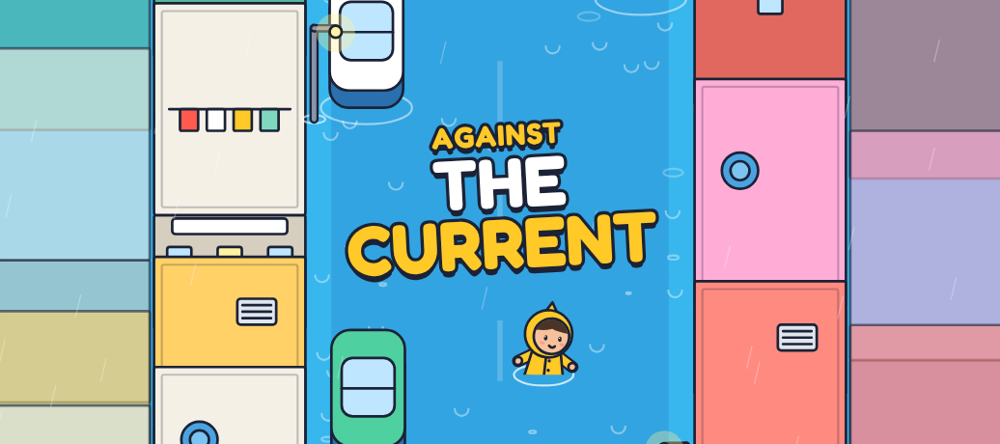
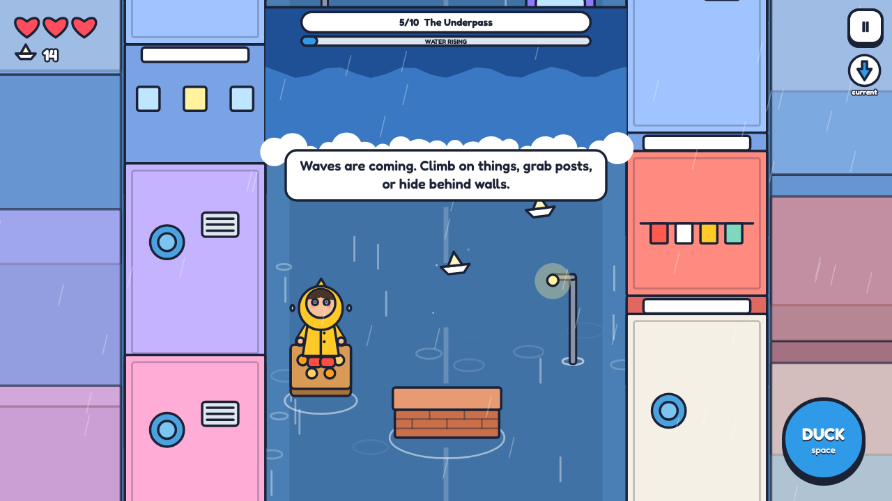

# Against the Current

A flooded town, a kid in a yellow raincoat, and somewhere dry at the far end. A browser game in one HTML file, no install.

**Play it:** https://mohib-ur-rehman-automation.github.io/against-the-current/

## How to play

| Do | How |
|---|---|
| **Wade** | Drag anywhere, or use the arrow keys / WASD |
| **Duck** | The round button, or Space |
| **Climb** | Walk into a parked car, cart or bus shelter and keep pushing. Push past the edge to hop down |
| **Escape a talker** | Tap, or press Space, as fast as you can |

Reach the dam at the end of each street. There are ten streets. You have three hearts, and every dam gives one back.

The water keeps rising. Dawdle too long on one street and it costs a heart.

## What is in the water

| Hazard | What it does | Answer |
|---|---|---|
| Garbage | Slows you down | Go around, or duck under |
| Open manhole | Pulls you in, costs a heart | Keep your distance |
| Muddy water | Hides pits. Only bubbles give them away | Go around, or watch for bubbles |
| Frog | Lands on your face and scrambles your steering | Duck to wash it off |
| Talker | Chases you, then talks for 1 minute 18 | Run, duck so he loses you, or tap to escape |
| Crow | Circles, then dives. It hates you for no reason | Duck just before it dives |
| Motorcycles and cars | Cost a heart | Stay out of the middle lanes when you hear a horn |

Pick up paper boats for score, a tyre tube for speed, an umbrella to block one crow, and chai for a heart.

## The waves

Streets 5 and 9 are wave arenas. A forecast names the next wave, and each kind has one right answer.

| Wave | Answer |
|---|---|
| Surge | Any shelter |
| Tall wave | Get up high: climb onto a roof |
| Ripper | Grab a lamp post. It tears you off roofs |
| Debris wave | Hide behind a wall, or behind someone big |

In the second arena, every cluster of shelter is missing one answer, so you have to move between waves.

## What is in the file

Everything is in `index.html`: plain JavaScript on a 2D canvas, no libraries, no build step, no server.

- **Characters:** drawn in code and animated, no image files.
- **Streets:** ten generated layouts, each with its own current: still, with you, against you, sideways, or turning.
- **Sound:** a generated score and all effects, synthesised in the browser. No audio files. Music and sounds have separate sliders in the pause menu.
- **Font:** Fredoka from Google Fonts. Offline, it falls back to a system font.

Settings are saved in your own browser and sent nowhere.

## How it was made

The idea, direction and playtesting are by Mohib Ur Rehman, from an old design note of his about a boy crossing a flooded town. The code was written by Claude Fable 5.2 (Anthropic) in November 2026. The rules were tuned by running an automated player through every street before any person played it.

## Known limits

- Tested in Chrome on a laptop and at phone size. Firefox and Safari are untested, and touch was only simulated.
- The characters are posed by code, so they move simply.
- The original idea had 50 levels and a town to build up. This version has ten streets and no building.

## Licence

MIT. See `LICENSE`.
